# Этап 2 — участок и постройки снаружи в 3D

Приложение: `dist/index.html` (`npm run serve` → http://127.0.0.1:8769/). Дом базы перенесён в
`dist/base-house.html` и проверяется отдельно.

## Что сделано

- **Рельеф** — по 156 отметкам съёмки (сплайн этапа 1), у построек планировка «пол − 0,25», пол навеса —
  на отметке хоз.блока; газон с хвойной подстилкой под кронами, за забором — луг и обобщённый лес на горизонте.
- **Постройки по листам, отделка по рендерам** — вертикальная доска светло-серого тона, белые угловые доски,
  наличники с замковым камнем, фриз под свесом, лобовые и ветровые доски, белые ПВХ-окна и остеклённые
  двери, графитовая металлочерепица с коньком и снегозадержателями, белые водостоки, стальные трубы,
  мансардные окна, цоколь из штукатурки (ж/б сваи), бетонные ступени у дверей:
  - гостевой дом-баня — основной объём с мансардой и вторым светом, переход со входом, баня;
  - гриль-дом — шестигранник с тремя фронтонами (З, СВ, ЮВ), обеденная площадка с перголой, стол и скамьи;
  - хоз.блок с секционными воротами и навес на две машины (опоры, обшитые доской, ригель до карниза).
- **Деревья** — 41 дерево с плана: порода, высота по диаметру ствола, ширина кроны по плану. Деревья,
  заслоняющие выбранную постройку, на виде скрываются (тени остаются) — флажок «Не заслонять постройки
  деревьями».
- **Благоустройство** — деревянный забор из горизонтальной доски, откатные ворота и калитка, дорожки и въезд
  из серой плитки с бордюром, гравийная отмостка, пруд с каменным берегом, деревянная купель, спортплощадка
  из серой резиновой крошки, две крышки ЛОС, кострище с живым огнём, гриль-зона с мангалом на плитняке,
  хвойные кусты у фасадов, высокая трава у забора и стволов.
- **Солнце и тени** для Всеволожска (60,02° с. ш.): время, дата, траектория, превью четырёх времён суток;
  вечером — костёр (авто), тёплый свет в окнах; белые ночи (21 июня в 22:40 солнце на −1,8°).
- **Интерфейс** — список построек (клик — перелёт к постройке), точки интереса (от ворот, кострище, пруд
  и купель, обеденная площадка), прогулка, кадр PNG, ссылка, качество; клавиши 1–4, R, T, C, N, [ ].
- **Прогулка** — от калитки; глаза на 1,62 м над рельефом/настилом; стены, опоры, стволы, пруд, купель,
  кострище, кусты и забор непроходимы. Внутрь построек — этап 3.

## Кадры

| | |
|---|---|
| 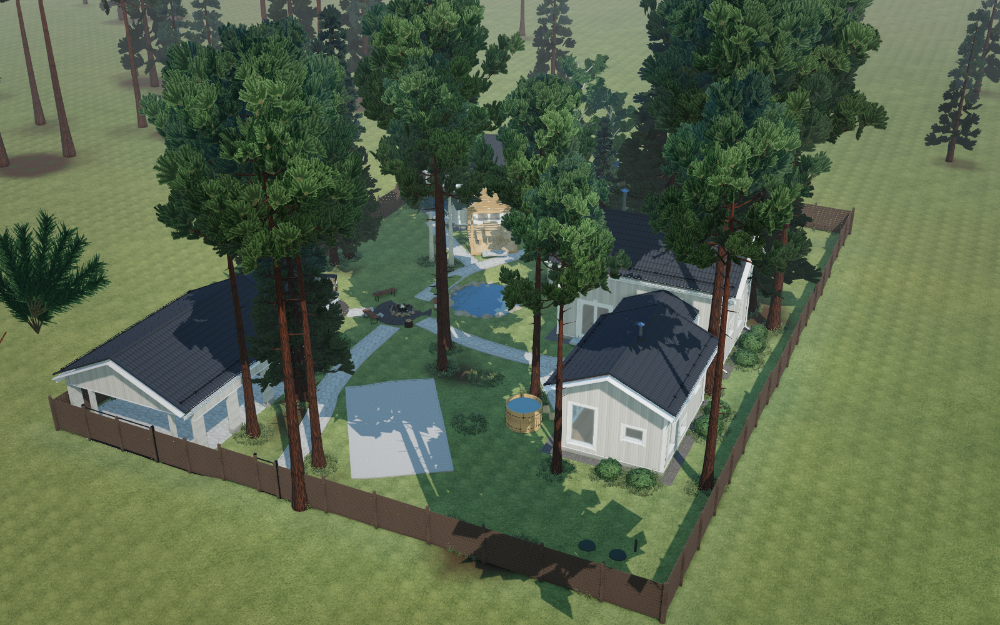 | 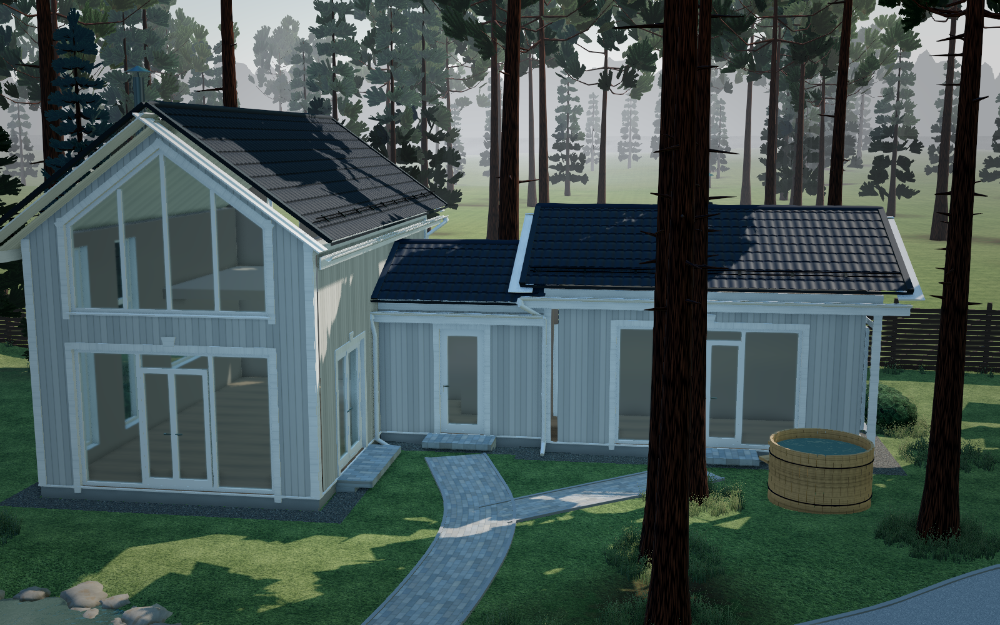 |
| 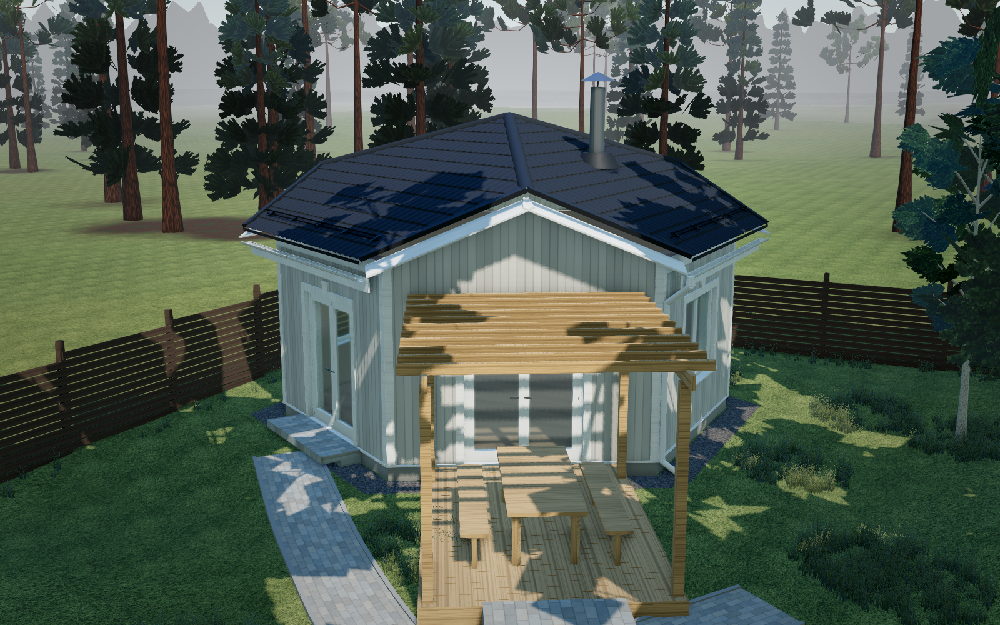 | 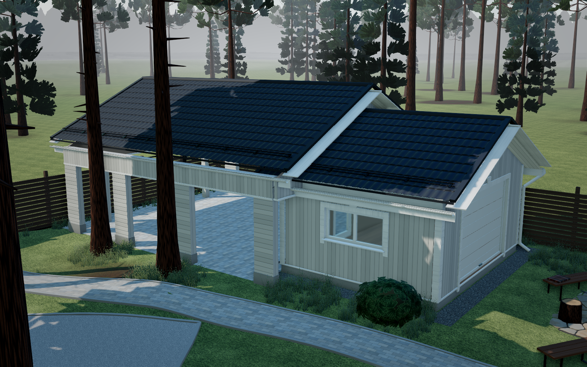 |
| 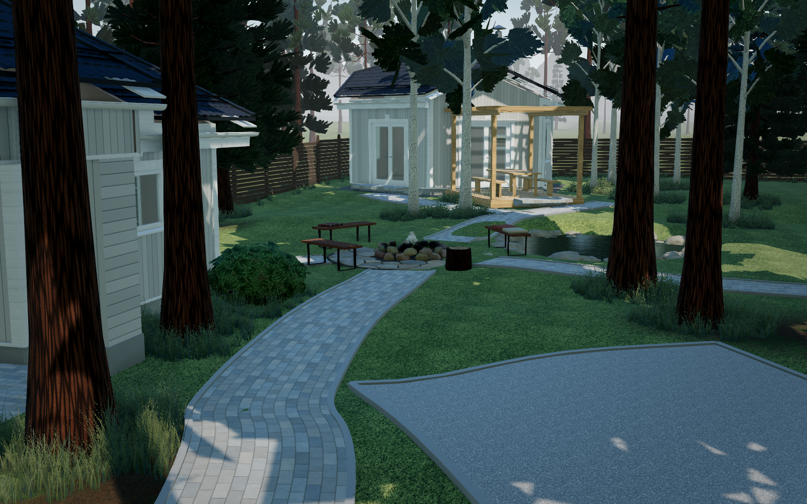 | 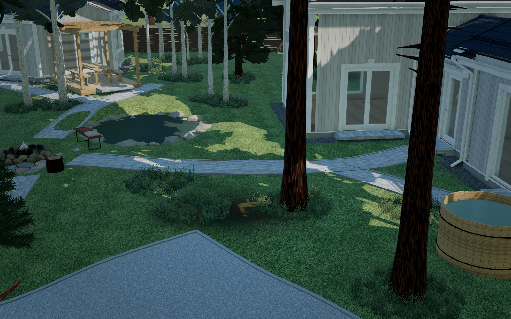 |
| 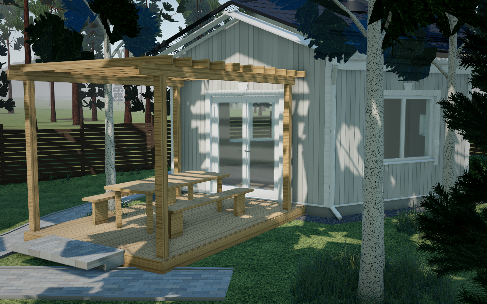 | 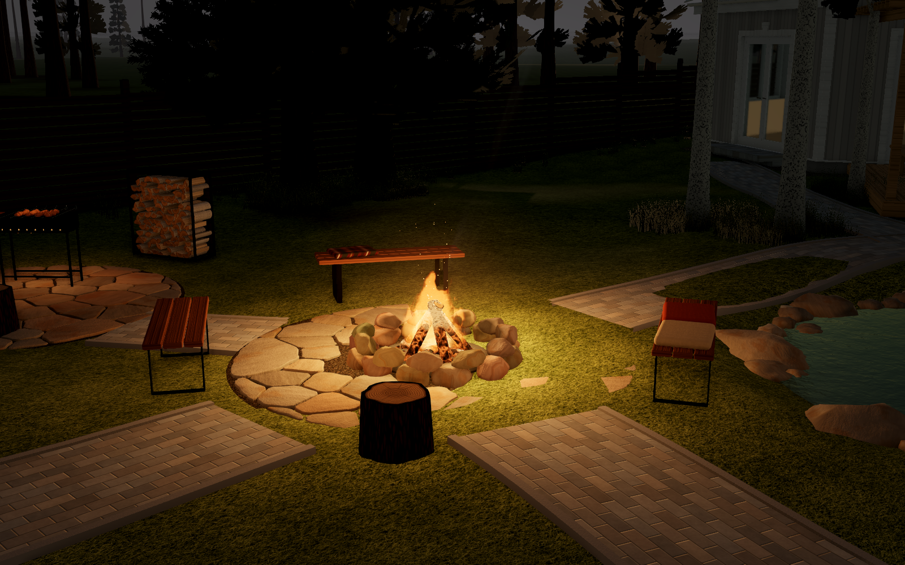 |
| 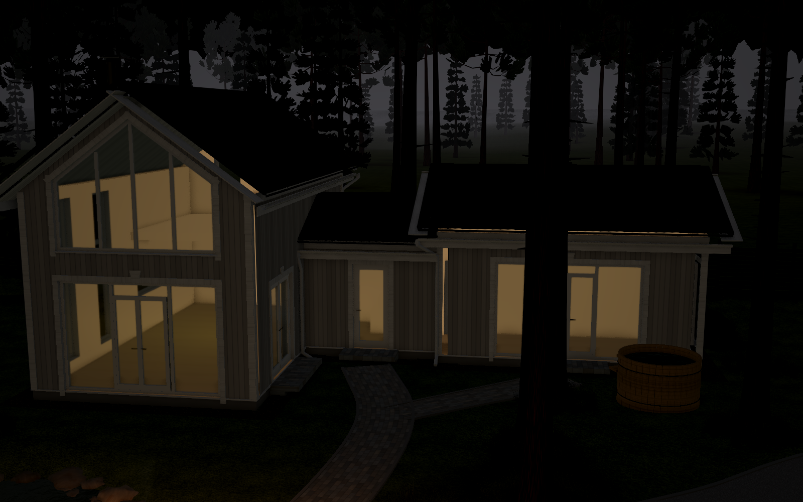 | 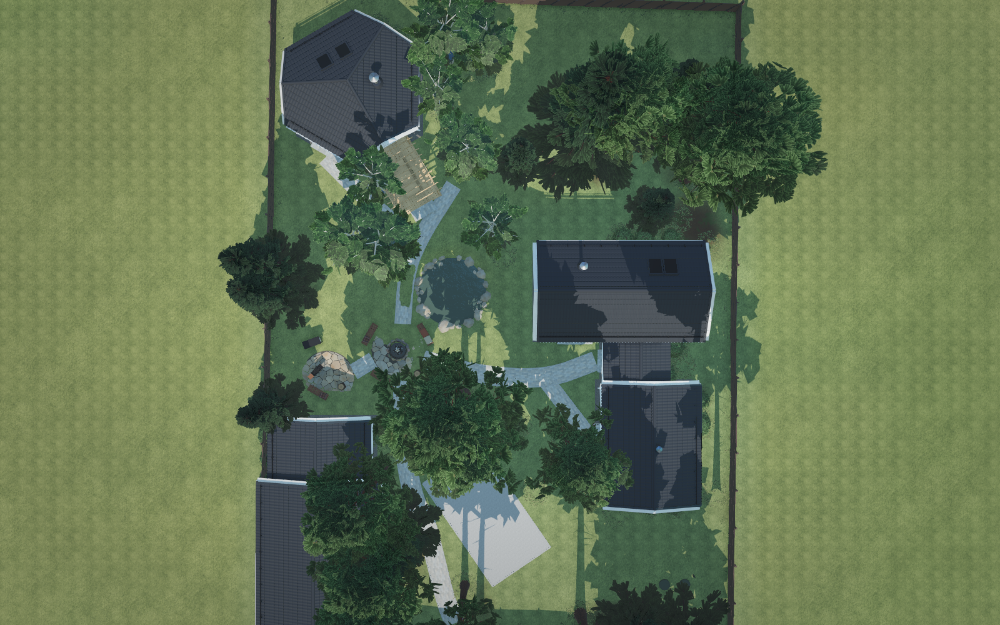 |
| 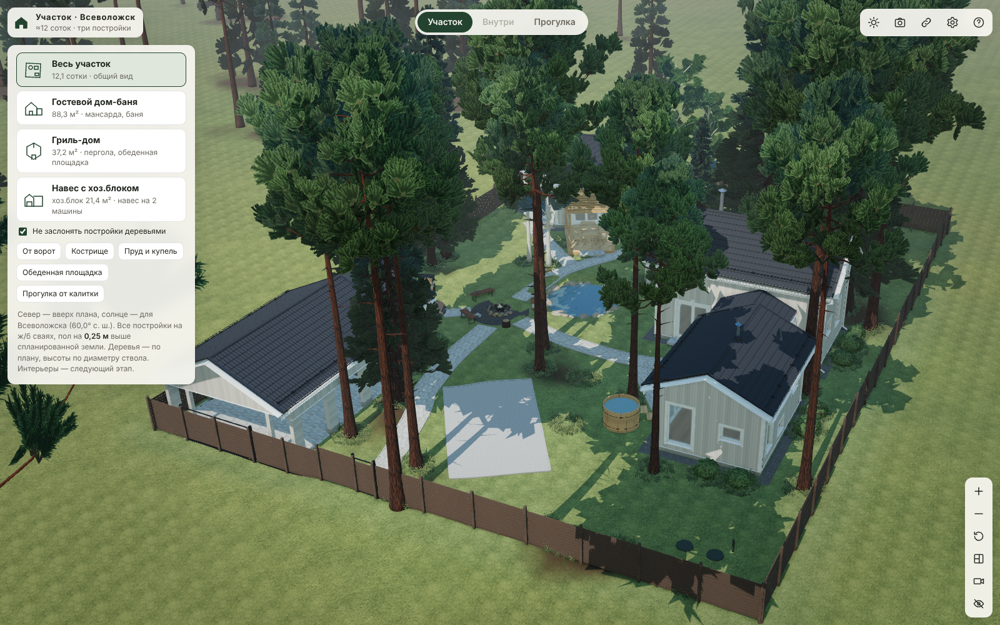 | 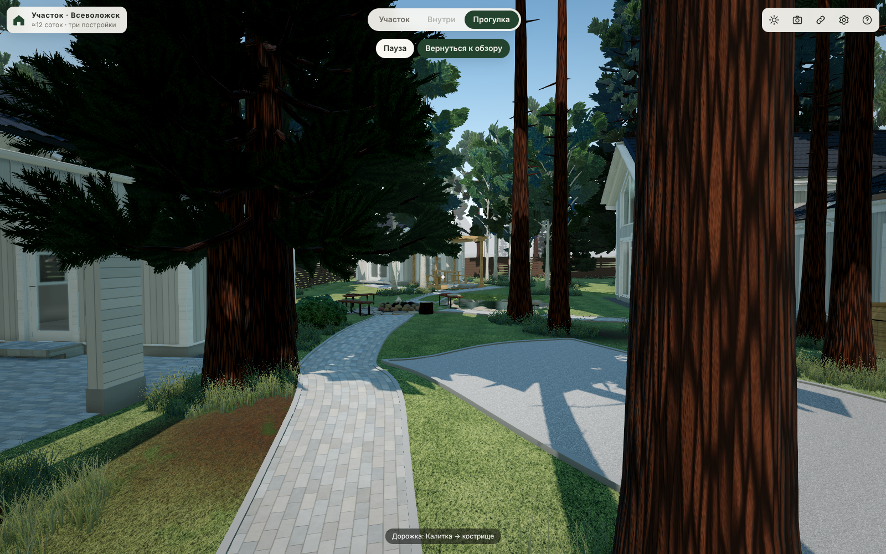 |

Телефон: [stage2-mobile.png](img/stage2-mobile.png). Все кадры — реальная отрисовка приложения в Chromium
с программным WebGL (`npm run site:shots`).

## Проверки

- `npm test` — модульные тесты, в т. ч. `tests/site-scene.test.mjs`: планировка у стен, пруд, деревья,
  коллизии прогулки, состояние и ссылка.
- `npm run site -- --check` — данные участка (этап 1).
- `npm run site:check` — браузерная проверка участка → `artifacts/site-check.json`, сводка — `docs/CHECKS.md`.

Решения и допущения этапа — `docs/ASSUMPTIONS.md`, раздел 8.
